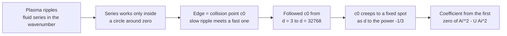
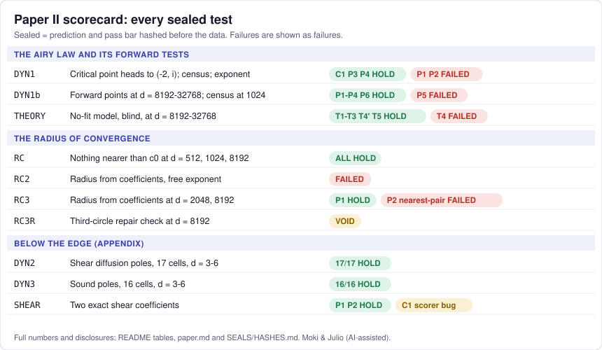

# The Airy edge: where the fluid picture of a black-hole plasma stops working

**A hot plasma modelled by a black hole behaves like a fluid, but only for ripples up to a certain size. The point that
sets that limit was known in three and four dimensions. We followed it out to 32768 dimensions and found that it creeps
towards a fixed spot at a rate of one over the cube root of the dimension, with a coefficient taken from a classic
function of physics, the Airy function (an approximation without error bounds).**

Moki & Julio (AI-assisted)

[](https://doi.org/10.5281/zenodo.23942230)


**Read** [paper.md](paper.md) · **Re-run** [REPRODUCE.md](REPRODUCE.md) (Python + mpmath, seconds to minutes) · **Check**
[SEALS/HASHES.md](SEALS/HASHES.md) · **Companion** [Paper I](https://github.com/Hashirama1337s/large-d-gregory-laflamme)

## The story in a minute

Holography is a way of modelling a hot plasma with a black hole in one extra dimension (here a flat "black brane" in
anti-de Sitter space, a curved space-time that acts like a box with a boundary). Stir such a plasma gently, with long, slow ripples, and it flows like a fluid. Physicists write
that fluid behaviour as a series: one term per power of the ripple's wavenumber (how tightly packed the ripples are).

Like many series, this one only converges up to some size of wavenumber. Past that size, adding terms no longer helps.
In 2019 Grozdanov, Kovtun, Starinets and Tadić showed what sets the size: a point where the slow fluid ripple collides
with one of the plasma's other, faster-decaying ripples. For a plasma in our 3 + 1 dimensional world (d = 4) they located
that point; for d = 3 it was located in 2022.

A picture that helps (it is only a picture): you can trust a road map only up to the nearest pothole, even if the
pothole sits off to the side of the road you drive on. Here the "side" is mathematical: the trouble spot sits at a
*complex* wavenumber (a number with two parts, written a + bi, where i times i is -1), not on any real road. Where the
picture breaks: a map has no single centre, while this series is built around zero wavenumber, so the limit is a circle
of trust around zero.

We followed that collision point, which we call c0, from d = 3 up to d = 32768. As d grows it creeps towards a fixed
spot, at a rate of one over the cube root of d. The coefficient comes from the first complex zero of a combination of
Airy functions, Ai'^2 - U Ai^2. The formula was derived from the equations, without fitting, by an approximation method
that gives no error bounds. The Airy turning point itself was known for large-D black holes since 2014 (Emparan, Suzuki,
Tanabe), and the Airy layer of this black brane at zero wavenumber since 2018; we extend it to complex wavenumber and
to the collision.

Why "d = 32768"? The equations can be solved for any number of dimensions d. d = 4 is a plasma in our 3 + 1
dimensional world and d = 3 a flat, two-dimensional one; thousands of dimensions are a mathematical lever that makes the
equations simpler, and they test the formula where it should be best.

Every scored prediction was written down and hashed before its answer was read, except where the scorecards flag
otherwise. That exception matters for the headline test (Step 3). Failures are listed as failures.

## Climb the ladder

### Step 1 - the idea (for anyone)

A series around zero works inside a circle whose edge is set by the nearest trouble spot. Find the trouble spot and you
know how far the fluid series for the ripple frequency can be pushed.



The fixed spot, written in thermal units as (qfr^2, wfr) = (-2, i), was not new: earlier work (2023) found qfr^2 = -2
as the singularity of a partially summed series at large d. What is new is how c0 approaches it, and the coefficient.

### Step 2 - how it works (for a curious student)

Measure the wavenumber q and the frequency omega in units of the plasma temperature: qfr = q/(2 pi T) and
wfr = omega/(2 pi T). Write q2 = qfr^2. The fluid series is a series in q2 about q2 = 0, and it works for |q2| < |c0|,
if c0 is the nearest trouble spot.

A textbook example of the same effect (not from this repo): the series for 1/(1 + x^2) is 1 - x^2 + x^4 - ... It stops
working at |x| = 1, although the function is smooth on the whole real line, because it blows up at the complex points
x = i and x = -i.

The law says that, as d grows,

    qfr_c^2 + 2 = A d^(-1/3) + ...,    wfr_c - i = B d^(-1/3) + ...,
    A = 1.021165 + 5.400669i,         B = 2.700334 - 0.510583i.

A and B come from U1 = -2.790298 + 1.094310i, the first zero (with positive imaginary part) of W(U) = Ai'(U)^2 - U Ai(U)^2,
where Ai' is the slope of Ai. The Airy function Ai is the classic solution of y'' = U y; it appears wherever a wave meets a turning point.

A worked example at d = 8192. The numerically computed critical point is c0 = -1.948369 + 0.268858i, so |c0| = 1.96683:
the fluid series in q2 reaches about that far. The leading law alone, -2 + A/8192^(1/3), misses it by 0.0014. A fuller
model built from the same derivation (model A, which adds the first 1/d correction and has no fitted parameters) misses
by 8.1e-6 (form shaped on d <= 4096, answers already on disk; see Step 3). The accuracy belongs to that full model, not
to the leading Airy term.

Where do the numbers come from? The c0 values are numerical: a separate seat solved the equations and refined them at
150 bits, and a deposit script (`code/table4.py`) re-checks them at 110 bits. The law and model A are analytic, except
that one input of model A, a slope equal to minus zeta(3) = -(1 + 1/8 + 1/27 + ...), was identified numerically.

### Step 3 - the real thing (for specialists)

- **Law.** For the shear channel of the planar AdS_{d+1} Schwarzschild black brane, the level-crossing critical point c0
  approaches (qfr^2, wfr) = (-2, i) as d^(-1/3), with A = -4 T1 2^(-1/3), B = 2i T1 2^(-1/3), T1 = Ai'(U1)/Ai(U1); no
  d^(-2/3) term; (qfr^2 + 2) - 2i(wfr - i) = 4/d + O(d^(-4/3)). Formal matched asymptotics, no remainder bound.
- **Forward test (BAR-THEORY), with its hedge.** Parameter-free model A predicted c0 at d = 8192, 16384, 32768 to
  8.1e-6, 2.6e-6, 8.2e-7 in qfr^2. This was not a blind test in the strict sense: the model's form was shaped while
  watching d <= 4096, and the computed answers were already on disk when the predictions were written. The test rests on
  the theory seat's word that it did not look.
- **Radius.** A numerical monodromy census places the radius of convergence in [|c0| - dr, |c0|] at d = 512, 1024 and
  8192 (dr = 0.005, 0.005, 0.002), barring a pole or a cancelling branch-point pair within one sector; one solver family.
  A second solver family, with exponent and fit model supplied in advance, is consistent with radius = |c0| at
  d = 2048 only; at d = 8192 it does not confirm it, and the
  repair test was VOID.
- **Below the edge.** Pade-resummed 1/d series agree with separately computed shear diffusion poles (17 of 17 sealed
  cells, 16 fresh) and sound poles (16 of 16, one a control) at d = 3..6, within sealed bars.
- **Pole skipping.** (-2, i) is also the d -> infinity limit of the published sound-channel pole-skipping point, which
  approaches it as 1/d, not d^(-1/3). We flag the coincidence as an open question, not a link.

Full wording, prior art (GKST19a/b, GL22, CHM18, EST14, GLP23 and others) and disclosures: [paper.md](paper.md). The
scorecard:



## Use it as a tool

Questions this lets you answer:

- Where is the shear critical point of the AdS_{d+1} black brane at large d, and so how far does its fluid series reach?
- What are the Airy constants U1, T1, A, B to 30 digits?
- Do the sealed predictions, verdicts and hashes check out?

**Re-run the headline numbers** (Python 3 with mpmath, numpy and gmpy2; run from the top folder). `-c core.autocrlf=false`
keeps the files byte for byte as committed; on Windows a default clone converts line endings and every line of the hash
check then fails.

```
git clone -c core.autocrlf=false https://github.com/Hashirama1337s/airy-edge-hydrodynamics
cd airy-edge-hydrodynamics
mkdir out
python code/airy_constants.py
python code/inner.py
python code/ntaylor.py
python code/ntaylor_hi.py
python code/critmodel.py bessel2 256 512 1024 2048 4096
python code/asym.py
python code/predict_THEORY.py
python code/verdict_THEORY_amended.py
sha256sum -c MANIFEST.sha256
```

`code/airy_constants.py` should end with

```
d =  8192  leading-law miss |q2 + 2 - A d^(-1/3)| = 0.0013615
d = 16384  leading-law miss |q2 + 2 - A d^(-1/3)| = 0.00067005
d = 32768  leading-law miss |q2 + 2 - A d^(-1/3)| = 0.00033089
```

and `code/verdict_THEORY_amended.py` with

```
{'T1': 'HOLDS', 'T2': 'HOLDS', 'T3': 'HOLDS', 'T4': 'FAILED', 'T4prime': 'HOLDS', 'T5': 'HOLDS'}
```

`out/PRED-THEORY.json` comes out byte-identical to the sealed prediction file `data/theory/PRED-THEORY.json`. Every
expected output, the d = 4 control (`code/table4.py`, about 1.5 min) and the longer census runs are in
[REPRODUCE.md](REPRODUCE.md). `MANIFEST.sha256` on the main branch covers the files as they are now, including this
README. To check the archived release (the Zenodo v1.0 deposit) instead, run `git checkout v1.0` right after `cd`, then
the same commands.

**Reuse the leading law at your own d.** This is the recipe of `code/airy_constants.py`, trimmed to a function:

```python
import mpmath as mp
mp.mp.dps = 30
W = lambda U: mp.airyai(U, 1)**2 - U * mp.airyai(U)**2      # Ai'^2 - U Ai^2
U1 = mp.findroot(W, mp.mpc(-2.79, 1.094))                    # first zero with Im U > 0
T1 = mp.airyai(U1, 1) / mp.airyai(U1)
c = mp.mpf(2) ** (-mp.mpf(1) / 3)
A, B = -4 * T1 * c, 2j * T1 * c

def edge(d):
    """Leading Airy law: (qfr^2, wfr) of the shear critical point c0 at dimension d (no 1/d terms)."""
    s = mp.mpf(d) ** (-mp.mpf(1) / 3)
    return -2 + A * s, 1j + B * s

q2, w = edge(8192)
print(mp.nstr(q2, 8), mp.nstr(w, 8))   # (-1.9493438 + 0.26790711j) (0.13395355 + 0.9746719j)
```

Compare with the computed c0(8192) = -1.94836923521368989578 + 0.26885790575211286270i: the miss is 0.0013615, as above.
For far better accuracy use model A: its values at d = 2^8 .. 2^27 are in `data/theory/asym.json` (key `model`). The law
is a large-d statement; at small d it is not accurate.

## What we did not show

- The Airy law comes from formal matched asymptotics with no error bounds. The input N1_t = -zeta(3) of model A is
  numerically identified. "On the hydro sheet" depends on the path convention (radial continuation from q2 ~ 0).
- The forward-test accuracy (8e-6 down to 8e-7) belongs to the full model A, which was shaped on d <= 4096. The computed
  answers were already on disk, so independence rests on the theory seat's self-report.
- The radius statement holds only at the listed d: monodromy at 512, 1024 and 8192 (blind to a thin band below |c0|, to
  poles and to cancelling branch-point pairs inside one sector; one solver family; scorer written after the data); the
  coefficient route is consistent at 2048 only; at 8192 it does not confirm, and the repair test was VOID.
- The radius is that of the series for the ripple frequency wfr(q2), not of the fluid's constitutive relations (how
  fluxes depend on densities); the two can differ.
- Whether c0 is the nearest trouble spot for every 4 < d < 512 is open (checked at d = 4 by others and at d = 256 here).
- One channel (shear) and one background (the neutral planar brane). Below the edge: agreement within sealed bars, not
  exactness, and the Pade convergence is not proved.
- Several sealed tests FAILED (BAR-DYN1 P1, P2; BAR-DYN1b P5; BAR-THEORY T4 as sealed; BAR-RC2 P1, P2; BAR-RC3 P2 under
  the nearest-pair reading) and one is VOID (BAR-RC3R). BAR-SHEAR C1 printed FAILED/INCOMPLETE (scorer key bug).
- The internal referee is a separately briefed seat of the same lab, not external peer review.

## Words you will meet

- **Holography / AdS black brane** - a black hole with a flat (planar) horizon in anti-de Sitter space, used as a model of
  a hot plasma; d is the number of dimensions of the plasma side.
- **Hydrodynamics (fluid series)** - the description of slow, long ripples as a fluid, written as a series in the
  wavenumber squared.
- **Radius of convergence** - how far from zero a series keeps working; set by the nearest trouble spot.
- **Critical point (c0)** - a complex wavenumber where two ripple frequencies of the plasma collide.
- **Complex number** - a number a + bi with i times i = -1; here wavenumbers and frequencies are allowed to be complex.
- **Airy function** - the classic solution of y'' = U y, found wherever a wave meets a turning point.
- **Matched asymptotics** - solving an equation separately in zones and stitching the pieces together; "formal" means
  without a proof of how big the leftover is.
- **Monodromy census** - walking the fluid solution around closed loops in the complex plane to detect trouble spots.
- **Pole skipping** - special points where a plasma response is ambiguous; known from earlier work.
- **Sealed test / seat** - predictions hashed before the answer is read; a seat is one separately briefed computation.

---

## For specialists: the original README

# The Airy edge of shear hydrodynamics: a large-d law for the critical point of the AdS_{d+1} black brane, with a numerical radius bound at d = 512, 1024 and 8192

Moki & Julio (AI-assisted)

[](https://doi.org/10.5281/zenodo.23942230)


**At a glance.** Fluid (hydrodynamic) predictions for the AdS black brane work only up to a certain momentum. The point
that sets that limit approaches (qfr^2, wfr) = (-2, i) as d^(-1/3) when the dimension d grows, with a coefficient from
the Airy function (formal matched asymptotics, no error bounds). A no-fit model predicted it blind at d = 8192-32768 to
8e-6 down to 8e-7, and a numerical census at d = 512, 1024 and 8192 found no nearer obstacle. Failures are shown.

**Read** [paper.md](paper.md) · **Re-run** [REPRODUCE.md](REPRODUCE.md) · **Check** [SEALS/HASHES.md](SEALS/HASHES.md) · **Companion** [Paper I](https://github.com/Hashirama1337s/large-d-gregory-laflamme)


This repository holds the preprint (paper.md), the data, the code that regenerates the headline numbers, and the sealed-test
records for Paper II. Archived at Zenodo: [doi:10.5281/zenodo.23942230](https://doi.org/10.5281/zenodo.23942230) (all versions;
v1.0 = 10.5281/zenodo.23942231). Companion paper (Paper I): doi:10.5281/zenodo.23940227.

## In plain words

A hot plasma of the kind studied with holography (a black brane in anti-de Sitter space) behaves like a fluid at long wavelengths.
The fluid description is a series in powers of the wavenumber, and like many series it only converges up to some size. Past that
size the series stops working. Where it stops is set by a point where the slow fluid mode collides with one of the fast modes. At
four dimensions that point was found in 2019.

We followed the same point from three dimensions up to 32768 dimensions. As the number of dimensions d grows, it creeps towards a
fixed point, at a rate of one over the cube root of d. The coefficient of that approach is set by the first complex zero of a simple
combination of Airy functions, Ai'^2 - U Ai^2. The formula was derived from the equations, without fitting, but by an approximation
method that gives no error bounds.

We then tested it. A model built from the derivation predicted where the point sits at d = 8192, 16384 and 32768, and the computed
values agreed to within 0.000008 at d = 8192, shrinking to 0.0000008 at d = 32768 (in a quantity of size about 2). The model's form
had been tuned while looking at d up to 4096, and the computed answers were already on disk when the predictions were written, so
this test rests on the theory seat's word that it did not look. The leading term of the formula alone is off by 0.0014 at d = 8192.

We also checked that this point really is the nearest obstacle, which is what makes it set the size limit. At d = 512, 1024 and 8192
a map of the complex plane showed nothing closer (up to a thin band and two kinds of feature the map cannot see). A second solver
family, with exponent and fit model supplied in advance, was consistent at d = 2048. At d = 8192 that second method was ambiguous, and an attempt to settle it was itself badly
designed, so it counts as void.

The fixed point the edge creeps towards is also where a known "pole-skipping" point of the sound channel ends up at infinite d. The
two points meet only in that limit, and at different speeds. A 2019 paper concluded from two other examples that pole skipping is
not directly related to where the fluid series stops. We do not claim a link; we flag the coincidence as an open question.

Below the edge, the same kind of 1/d series predicted how the plasma diffuses momentum and carries sound at 3 to 6 dimensions, within
the error bars written down beforehand, in every one of 33 sealed cells.

Every scored prediction was written down and hashed before the answer was read, except where the scorecards below flag otherwise.
Some predictions failed; they are listed as failures.

## Scorecard

HOLDS means the prediction passed the bar written before the data; FAILED and VOID are reported as such. Errors are absolute in
qfr^2 for the critical point and relative for the poles.

### The law and its forward tests

| Test | Prediction (short) | Verdict | Realised numbers / disclosure |
|---|---|---|---|
| BAR-DYN1 C1 | d = 4 control | HOLDS | all 8 published digits; published value was the Newton seed |
| BAR-DYN1 P1 | census at every d | FAILED | census only at d = 256 |
| BAR-DYN1 P2 | limit within 0.05 of (-2, i), two fit families | FAILED | 0.011 and 0.107 |
| BAR-DYN1 P3, P4 | approach exponent; \|q2\| < 2 by d = 1024 | HOLD | 0.339; 1.967 |
| BAR-DYN1 N1 | null | HOLDS (cannot fail) | - |
| BAR-DYN1b P1-P4 | fit predictions at d = 8192, 16384, 32768; refit limit | HOLD | 4.2e-5 .. 2.8e-4, about 20x inside bars |
| BAR-DYN1b P5 | census at d = 512, 1024 | FAILED | d = 1024 annulus uncertified |
| BAR-DYN1b P6 | closer to d^(-1/3) family than rival | HOLDS | sealed after blind values were on disk |
| BAR-THEORY T1 | parameter-free model A | HOLDS | 8.1e-6 .. 8.2e-7; independence by self-report; form shaped on d <= 4096 |
| BAR-THEORY T2, T3, T5 | calibrated model; residual exponent; on-sheet branch point | HOLD | 9.7e-8 .. 1.8e-8; 1.02; swap at 8192 |
| BAR-THEORY T4 / T4' | 4/d relation within 0.05 / monotone, near 0.069 | FAILED (mis-set before data) / HOLDS | 0.0688 at d = 32768 |

### The radius

| Test | Prediction (short) | Verdict | Realised numbers / disclosure |
|---|---|---|---|
| BAR-RC P0 | positive control just outside c0 | PASS at all d | 8192 margin 1.6x |
| BAR-RC P1-P3 | nothing inside \|c0\| - dr at d = 1024, 512, 8192 | HOLD | <= 9.2e-14; scorer written after data; three code versions |
| BAR-RC2 P1, P2 | free-exponent radius = \|c0\| to 1% | FAILED | 1.05e-2, 1.68e-2 |
| BAR-RC3 SPC, P1 | synthetic control; radius at d = 2048 | PASS; HOLDS | 6.5e-6; 1.1e-5; exponent and model supplied |
| BAR-RC3 P2 | radius at d = 8192 | HOLDS as printed; nearest-pair reading FAILED | 5.3e-5 reported pair; 7.95e-3 nearest pair |
| BAR-RC3R | third-circle check at d = 8192 | VOID (inner control FAILED) | bar ignored aliasing; descriptive reading post hoc |

### Below the edge (appendix)

| Test | Prediction (short) | Verdict | Realised numbers / disclosure |
|---|---|---|---|
| BAR-DYN2 | shear diffusion pole, 17 cells at d = 3..6 | 17/17 HOLD | 16 fresh; 2.2-17 digits; independence medium |
| BAR-DYN3 | sound pole, 16 cells at d = 3..6 | 16/16 HOLD | 15 fresh + 1 control; all within 1 x bar |
| BAR-SHEAR P1, P2 | two shear coefficients vs published estimates | HOLD | closed forms identified (descriptive) |
| BAR-SHEAR C1 | controls | printed FAILED/INCOMPLETE | scorer key bug |

The disclosures behind each row are stated next to each test in the paper (Sections 4-5, Appendices B-D).

## Release contents

- paper.md: the preprint.
- data/: the blind tracked critical points (d = 4..32768, the d = 3 continuation and the high-precision refinements); the theory
  seat's model files and predictions; the monodromy-census results at d = 512, 1024 and 8192; the Cauchy coefficients, ladder fits and
  results of the coefficient route (RC2, RC3, RC3R); the predictions and blind poles of the two pole tests. data/REDACTED.md lists the
  data files changed by redaction.
- code/: the critical-point solver (qnmx.py, lib.py), continuation and refinement drivers (track.py, down.py, refine.py); the
  theory seat's model-A generator (inner.py, ntaylor*.py, critmodel.py, asym.py, predict_THEORY.py); the census code (rc*.py,
  sector.py, make_result_RC.py); the predictors and scorers of every sealed test; code/rc3/ with the coefficient-route seat's
  scripts; and four scripts written for this deposit: airy_constants.py, table4.py, rc3_pairs.py and p6_check.py. Lab scripts are copies in which
  only file paths were changed.
- SEALS/: for each sealed test, the files listed in its seal, the seal files, and SEALS/HASHES.md (sealed hash, whether the lab
  original still matches, hash of the deposited copy, redacted or not).
- REPRODUCE.md: commands, captured outputs and run times. MANIFEST.sha256: hashes of all files.
- LICENSE (CC BY 4.0, everything except code/), LICENSE-CODE (MIT, code/), CITATION.cff, .zenodo.json.
